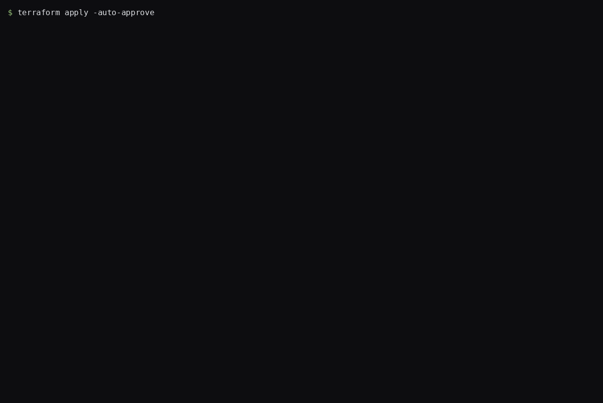

# Autonomous Systematic Mechanical Reconcilliation

_Self-service framework for {{ .user.firstName }}._

---



---

**Start here:** Platformer reaches its clouds through providers it builds from source. Before your first `terraform init`, and again whenever `lazyprovider/VERSION` changes, run:

```sh
scripts/build-providers.sh
```

It fetches its own Go toolchain (no Go install needed), tests and builds the providers, and installs them where Terraform looks for local plugins. If you skip it, `terraform init` stops with _"could not connect to platformer.local"_ (after about 15 seconds of retries). The [lazyprovider README](lazyprovider/README.md) explains why the providers exist.

---

## description

A **Platformer** combines Platform Architecture + Terraform(er), reflecting a team identity and technical approach. Like the game genre, we build foundations for others to launch from. The "-former" suffix is a nod to modern AI (transformers) and the technological singularity within us all.

Platformer is one Terraform configuration for every account, region and cloud. Modules are switched on and configured by YAML fragments, and a module that needs infrastructure asks for it: the modules that provide it (storage, compute) turn on to fulfill the request. AWS and Oracle Cloud share one graph, and a workspace only needs credentials for the clouds it uses. [next/foundations.md](next/foundations.md) covers the design and where its ideas come from; [next/fully-connected.md](next/fully-connected.md) covers the multi-cloud design.

<details>

<summary>modules</summary>

<!-- AUTODOC:MODULES:BEGIN -->

- **[`access/`](access/README.md)** - Centralized access control reporting using dependency inversion.
- **[`applications/`](applications/README.md)** - Data transformation layer for application deployment.
- **[`arcbot/`](arcbot/README.md)** - Multi-target AI bot module.
- **[`archivist/`](archivist/README.md)** - Produces a scrubbed, versioned tarball of the `platformer/` codebase on every `terraform apply`.
- **[`auto-docs/`](auto-docs/README.md)** - Automatic documentation generator for Platformer modules - parses `variables.tf` files and generates `SCHEMA.md` with YAML examples.
- **[`build/`](build/README.md)** - Golden AMI builds for EC2 classes using Packer with SSM communicator.
- **[`clairevoyance/`](clairevoyance/README.md)** - Medical AI inference platform on AWS SageMaker.
- **[`compute/`](compute/README.md)** - Unified compute provisioning with type-based routing.
- **[`config/`](config/README.md)** - Configuration resolution via YAML fragments.
- **[`configuration-management/`](configuration-management/README.md)** - Automated configuration management for EC2 instances using AWS Systems Manager.
- **[`domains/`](domains/README.md)** - Route53 zone lookup and ACM wildcard certificate provisioning with DNS validation.
- **[`hashing/`](hashing/README.md)** - Deterministic namespace generation for parallel deployments.
- **[`iopacs/`](iopacs/README.md)** - (WIP) Domain orchestration for IOPACS medical imaging PACS deployments using dependency inversion pattern.
- **[`iorchestrator/`](iorchestrator/README.md)** - Domain orchestration module for IOrchestrator (IO Cloud / SaaSApp) deployments on AWS ECS Fargate.
- **[`ioshare/`](ioshare/README.md)** - Domain orchestration module for Ioshare medical imaging platform.
- **[`legacy/`](legacy/README.md)** - Disposable EC2 instance with Atlantis pre-built via Packer.
- **[`networking/`](networking/README.md)** - VPC and subnet management with deterministic CIDR allocation.
- **[`observability/`](observability/README.md)** - LGTM stack (Loki, Grafana, Tempo, Mimir) for centralized logging and observability.
- **[`portal/`](portal/README.md)** - Ephemeral Port.io integration for compute instance catalog visualization and self-service actions.
- **[`preflight/`](preflight/README.md)** - Reusable dependency validation utilities for checking CLI tool availability.
- **[`resolver/`](resolver/README.md)** - Dependency resolution engine.
- **[`secrets/`](secrets/README.md)** - Cross-account secret replication.
- **[`storage/`](storage/README.md)** - Centralized S3 bucket provisioning using dependency inversion.
- **[`tenants/`](tenants/README.md)** - Centralized tenant registry and validation.
- **[`tests/`](tests/README.md)** - Root-level test suites and the module test runner.
- **[`workspaces/`](workspaces/README.md)** - Enables workspace-specific variable overrides using `terraform.tfvars.{workspace}` files.

<!-- AUTODOC:MODULES:END -->

</details>

<details>

<summary>layout</summary>

<!-- AUTODOC:LAYOUT:BEGIN -->

- **[`fragments/`](fragments/README.md)** - Reusable pieces of configuration, loaded by name and merged in order (`fragments` in `terraform.tfvars`, or `top.yaml` in CI).
- **[`lazyprovider/`](lazyprovider/README.md)** - Platformer declares its clouds through `platformer.local/lazyprovider/<cloud>` providers: small proxies that stand in front of the real providers (`hashicorp/aws`, `oracle/oci`, `port-labs/port-labs`) and set them up only in workspaces that enable them.
- **[`learn/`](learn/)** - Walkthroughs: getting started, going live, and composing modules.
- **[`next/`](next/)** - Essays on the design: why Platformer is shaped the way it is, and where it goes next.
- **[`present/`](present/)** - A slide deck: the problem, the solution, and the patterns in between.
- **[`scripts/`](scripts/)** - Helper scripts. `build-providers.sh` builds the cloud providers; the rest record applies and generate CI matrices.
- **[`static/`](static/)** - Images used in the README.
- **[`main.tf`](main.tf)** - Wires every module together: config in, requests routed between modules.
- **[`providers.tf`](providers.tf)** - The clouds, each with an `enabled` switch that follows the workspace's profiles.
- **[`top.yaml`](top.yaml)** - Multi-account targeting: account patterns mapped to fragments.
- **[`terraform.tfvars`](terraform.tfvars)** - Local configuration: profiles, region, and the fragments to load. `terraform.tfvars.<workspace>` overrides it per workspace.
- **[`SCHEMA.md`](SCHEMA.md)** - Every option a fragment can set, generated from the modules' variables.

<!-- AUTODOC:LAYOUT:END -->

</details>

<details>

<summary>installation and usage</summary>

## getting started

1. Build the providers: `scripts/build-providers.sh` (once per provider version).
2. `terraform init`
3. Say what to deploy: copy `terraform.tfvars.example` to `terraform.tfvars` and set at least:

   ```hcl
   aws_profile = "example-platform-dev"        # a profile from ~/.aws/config
   aws_region  = "us-east-2"
   fragments      = ["configuration-management-hourly"]
   ```

4. `terraform plan`, then `terraform apply`.

With no fragments, a plan deploys nothing. [learn/1-getting-started.md](learn/1-getting-started.md) walks through a first deployment.

## clouds

A workspace switches a cloud on by naming its profile: `aws_profile`, `oci_profile` (with `oci_region`), or `port_enabled = true`. A cloud that isn't named is never set up, so it needs no account or credentials.

## workspaces

`terraform workspace select <name>` loads `terraform.tfvars.<name>` over `terraform.tfvars`, so each workspace can carry its own profiles and fragments. See [workspaces/README.md](workspaces/README.md).

## prerequisites

- Terraform 1.8 or newer
- Python 3 (plans run small Python helpers, such as the docs generator)
- `curl`, `tar` and `sha256sum`, for `scripts/build-providers.sh`

Some modules check for more tools when they're used:

<!-- AUTODOC:PREREQUISITES:BEGIN -->

- `docker` (portal)
- `docker compose` or `docker-compose` (portal)

<!-- AUTODOC:PREREQUISITES:END -->

## rebuilding the providers

- After `lazyprovider/VERSION` changes: `scripts/build-providers.sh`, then `terraform init`.
- After rebuilding the same version (for example, while working on `lazyprovider/`): `scripts/build-providers.sh`, then `terraform init -upgrade`, because the lock file pins each provider package by its hash.

## testing

```sh
terraform test                                          # every suite, module suites included
terraform test -filter=tests/variables.tftest.hcl       # one suite
cd compute && terraform init && terraform test         # one module's suites
```

See [tests/README.md](tests/README.md).

## going further

- [learn/2-going-live.md](learn/2-going-live.md) - tenants, compute classes and entitlements.
- [learn/3-module-composition.md](learn/3-module-composition.md) - adding a module.
- [fragments/README.md](fragments/README.md) - how fragments load and merge, `top.yaml` targeting, and fragments kept outside the repo (`fragment_paths`).
- [SCHEMA.md](SCHEMA.md) - every option a fragment can set.

</details>
